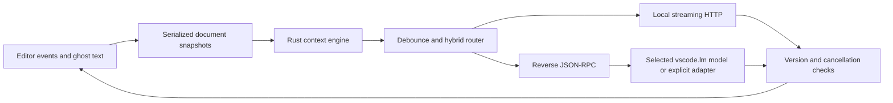

# Architecture and decisions

Since 0.3.7 the extension can supplement open-document context with up to four
direct relative TS/JS imports from the trusted workspace. Canonical paths,
source extensions, exclusion rules and a 64 KB per-file cap bound reads; no
editor is opened and no code or package resolver runs. Request-scoped references
are parsed into the existing symbol-ranking path without entering persistent
document/history storage. Open buffers take priority. A two-second/eight-entry
read cache and tracked source-file events support reuse and invalidation.
`superborrow.importContext:false` disables supplementary reads. This is source
context for the selected model, not local AI inference.

The TypeScript extension owns editor state and model access. Rust owns bounded
context, routing and local HTTP. The wire is a bidirectional JSON-RPC profile
over Content-Length-framed stdin/stdout. This is not an LSP implementation.

## Context

Full snapshots keep the wire simple and resilient to missed editor events.
`DocumentSync` serializes snapshots and closes, ignores obsolete versions, and
evicts the oldest tracked document at the 16-document client limit. Rust accepts
32 documents and 8 MiB total, limiting each to 512 KiB. Closing a document also
removes its history entries. Disabling completion disposes the process.

Rust derives one conservative contiguous change by finding common byte prefix
and suffix while preserving UTF-8 boundaries. It applies a tree-sitter InputEdit
and reuses the edited old tree. This covers replacements, deletions, Unicode and
multiple edits in one snapshot; the change can be wider than individual edits.
Grammar support: Rust, TS/TSX, JS/JSX, Python. Other languages retain text FIM.

The global history ring stores at most 10 unified diffs, 4 KiB per entry. Diff
inputs over 64 KiB use a size summary to bound expensive diff work. Context
contains project notes first, open-file signatures in URI order, then syntax /
recent edits, then the nearest prefix/suffix. Prompt budgets count UTF-8 bytes,
not model tokens; the IDE bridge separately counts input tokens.

## Providers and lifetimes

`CompletionProvider` has local and IDE implementations. The local provider reuses
one reqwest Client, disables redirects/proxies, and accepts only loopback HTTP.
It supports llama.cpp SSE, Ollama NDJSON and OpenAI-compatible completion SSE.
UTF-8 decoding happens only after a whole stream line is assembled. Wire and
output limits prevent an endless stream from accumulating indefinitely.
Output is accumulated for one ghost-text response; token-by-token UI updates
are not implemented. Cancelling drops the HTTP request/response stream.

The server's select loop handles frames and provider events concurrently.
Each job has a unique generation, document version and CancellationToken. New
work for the same document, a document change/close, reconfiguration or explicit
cancel invalidates the old job. Reverse IDs are distinct string IDs; completions
may arrive out of order. Late events cannot resolve a replacement job.
Cancellation removes jobs/reverse callbacks before replying; provider tasks
observe cancellation and release HTTP/IDE resources. EOF/shutdown ends the core.

Automatic requests wait the configurable debounce (default 60 ms). Explicit
requests skip it. End-to-end timeout includes debounce and fallback. Maximum 16
active jobs and 64 queued provider events bound concurrency.

Hybrid routing is intentionally a transparent heuristic, not a trained policy:
small inline contexts prefer local; block-start / large-prefix / next-edit
requests prefer IDE only if the user has selected an available provider. With a
selected IDE model, local has at most 1.5 seconds or half the request timeout
before fallback. Other failures can trigger one fallback. Local and IDE modes
never silently switch providers. `hybridPreference: ide` makes the available IDE
model primary for every language; `local` prefers the local server; `auto` keeps
the context heuristic. An unavailable IDE leaves Hybrid local. Reapplying an
identical configuration is idempotent and does not cancel a running job.

## Editor and models

An inline result is accepted only if document version, context epoch and
cancellation state still match. A 32-entry / 2-second cache serves identical
positions; any context/configuration change clears it. Existing suffix overlap
is removed, and generated newlines follow the document EOL. Suggestions never
apply edits until the user accepts ghost text through the editor.

In Antigravity, startup activates the installed `google.google-antigravity`
extension through the normal extension API. Its exported `getRpcClient()`
provides `getAvailableModels` and `getModelResponse`; the latter is a pure model
request, not an agent conversation with tools. The catalog is reduced to model
IDs, names and enabled flags. Authentication and transport remain inside the
host extension. No session files, tokens or private HTTP transport are used.
This integration was inspected against host extension 1.11.0 and is not a
guarantee of a stable public API across future releases; capability checks and
Hybrid fallback handle incompatibility explicitly.

`ideModel: auto` deterministically prefers an enabled fast text model. Explicit
`antigravity:<slug>` selections are persisted in editor configuration and
restored on startup. `vscode:<id>` selections use the portable `vscode.lm` path;
initial consent/selection still happens through a user command. Discovery does
not send a generation prompt. Temporarily unavailable host metadata is retried
with exponential backoff from 1.5 to 30 seconds while enabled. Startup/discovery work is coalesced so extension
activation events cannot repeatedly reconfigure an in-flight completion.
Cancellation is bridged to AbortSignal / vscode's token.

The host's native inline provider otherwise competes with Superborrow. An
explicit **Use Superborrow for Tab** command opts into native Tab coordination.
It uses the host's exported unified state API, with a single-row update to
`uss-tabPreferences.tabEnabled` (OFF=1, ON=2), preserving the previous value in
extension global state. No other preference is written. **Restore Antigravity
Tab** restores that value and pauses Superborrow. This is persistent selection,
not a temporary per-window lease. Unknown row encodings fail before a write.
The opt-in is machine-scoped and defaults off in the distributed manifest.
Acceptance is recorded by the command attached to each Superborrow item; live
tests cannot pass merely by accepting a different provider's output.
An explicitly configured extension may export the adapter contract documented
in ide-adapter.md. Diagnostic discovery reads export descriptors of active
extensions and lists candidate command IDs; it neither activates all extensions
nor invokes undocumented commands.

Next Edit operates on a selection or current line. The core prepares a gap
around that range and provides its original content plus the instruction and
recent edits. The extension displays before/after snapshots and checks the
original version immediately before a single WorkspaceEdit. Output is a
proposal, not an inferred semantic guarantee. Automatic edit-location
prediction, multi-file edits and permanent repository indexing are future work.

## Sources for the adapter formats

- [llama.cpp server](https://github.com/ggml-org/llama.cpp/blob/master/tools/server/README.md): `/infill` receives separate prefix/suffix and additional context.
- [Ollama generate](https://docs.ollama.com/api/generate): raw prompting, streaming and generation options.
- [VS Code model API](https://code.visualstudio.com/api/extension-guides/ai/language-model): selection, user consent, streaming and cancellation.
- [Tree-sitter edit](https://docs.rs/tree-sitter/latest/tree_sitter/struct.Tree.html#method.edit): byte/point edits before incremental reparse.
- [Qwen FIM tokenizer](https://huggingface.co/Qwen/Qwen2.5-Coder-7B/blob/main/tokenizer_config.json) and [Codestral tokenizer](https://huggingface.co/mistralai/Codestral-22B-v0.1): raw FIM token conventions.

## Relevant context in 0.3.3

Document updates cache bounded declaration/type/import summaries. The request
path ranks those cached summaries by cursor identifiers and imported module hints,
including exported wrappers, class APIs and distant declarations in the active
file. Nearby editor errors/warnings are bounded advisory request data. Changes
to relevant diagnostics invalidate cached/in-flight suggestions and coalesce a
retry only if the same enabled editor/version/cursor remains active. Prompt byte
budgets include the chat task and framing. See validation.md for measured
before/after field-selection accuracy and remaining latency limits.

## In-flight typing in 0.3.4

IDE-only inline completion uses capability-gated, read-only prompt preparation
and client-owned generation. DocumentSync makes synchronization/preparation
atomic, while the core continues to accept later document updates. A bounded
client session races the oldest still-compatible prediction with a fresh one,
then checks the complete insertion history and exact generated prefix before
reusing old output. Other edits or semantic context changes cancel the session.
Nonparticipating virtual-document changes and stale off-caret requests do not
interrupt the actual code prediction. `speculativeTyping:false` restores the
version-bound path. At most two client jobs and finite deadlines bound speculative
work; remote cancellation latency and model quota use remain provider-dependent.
See validation.md for both useful reuse and the limits of the small live sample.
